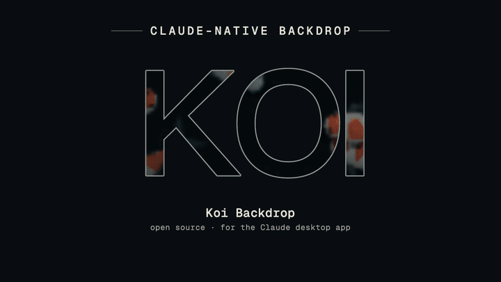
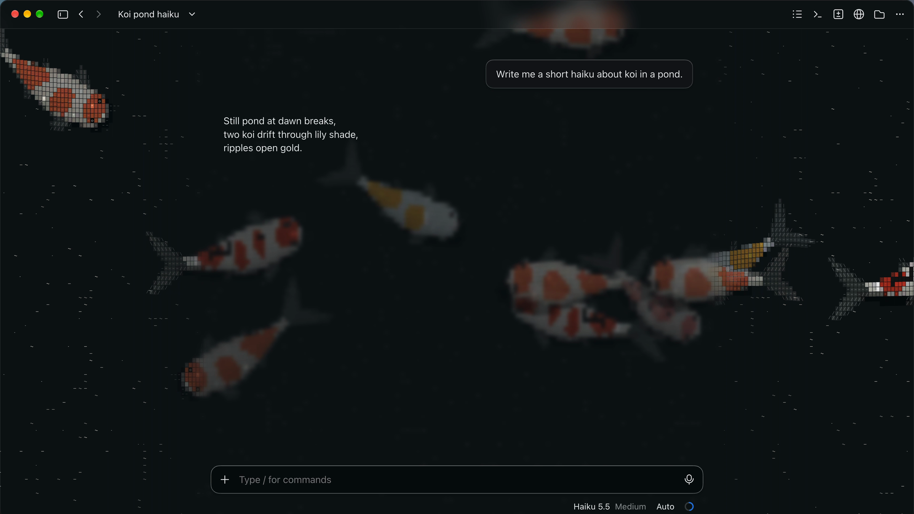
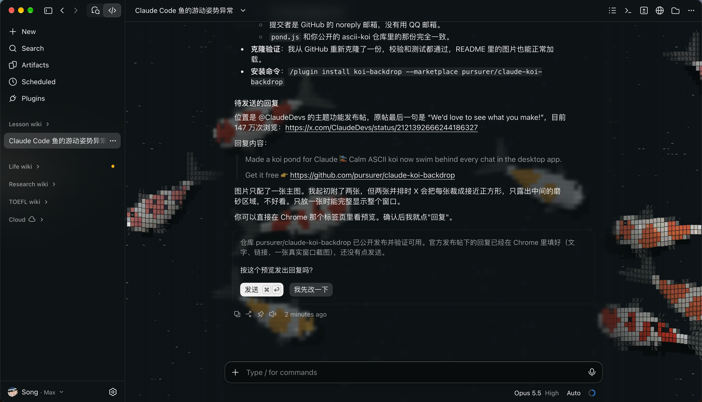
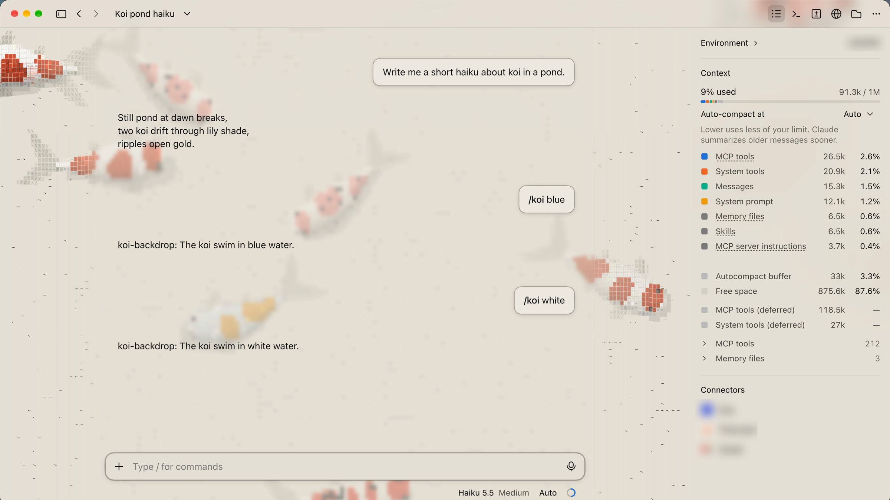

# Koi Backdrop

**A calm koi pond behind your conversations in the Claude desktop app.** Twelve [ASCII Koi](https://github.com/pursurer/ascii-koi) drawn in text-character tiles swim across the window, their tails beating, light glinting on their scales, over a softly drifting caustic net. The app's panels frost over the pond, so the chat stays easy to read.

<p align="center">
  <a href="#the-film"></a>
</p>

<p align="center"><a href="#install"><b>▶ Install (one command)</b></a> &nbsp;·&nbsp; <a href="#the-film">Watch the film (38 s, sound on)</a> &nbsp;·&nbsp; <a href="#use">The /koi command</a></p>

<!-- family-nav:start -->
<p align="center"><sub>Part of the <a href="#the-ascii-koi-family">ASCII Koi family</a>: <a href="https://github.com/pursurer/ascii-koi">ASCII Koi</a> · <a href="https://github.com/pursurer/codex-koi">Codex Koi</a> · <b>Koi Backdrop</b> · <a href="https://github.com/pursurer/one-page-is-all-you-need">One Page</a></sub></p>
<!-- family-nav:end -->

## What you get

<p align="center">
  
</p>
<p align="center">
  
  
</p>

The pond fills the whole window, behind the sidebar and the session rail too, in black, blue or white water. Every koi is painted by ASCII Koi's own `pond.js`, unchanged.

## The film

https://github.com/user-attachments/assets/95db123a-1041-4416-b863-3b92ee3da65e

38 seconds, sound on, one take in the real app: `/koi blue`, `/koi white`, `/koi black`, the sidebar and the session rail, with a score written for the film.

## Install

At the prompt of a Claude Code terminal session:

```
/plugin install koi-backdrop --marketplace pursurer/claude-koi-backdrop
```

Answer `y` to add the marketplace, then pick a scope. From a shell:

```bash
claude plugin install koi-backdrop --marketplace pursurer/claude-koi-backdrop
```

In the desktop app, where `/plugin` does not run: click **+** next to the prompt box, then **Plugins**, **Add marketplace** with `pursurer/claude-koi-backdrop`, then **Add plugin**.

The pond appears behind the next conversation you open in the desktop app (or on mobile). A terminal has no backdrop, so there the mod only adds the `/koi` command.

## Use

| Command | What it does |
| --- | --- |
| `/koi` | Says which water is on |
| `/koi black` · `/koi blue` · `/koi white` | Changes the water |
| `/koi size <50-160>` | Makes the koi smaller or larger, in percent (default 100) |
| `/koi glass <blur 0-64> <opacity 0-1>` | Sets how the app's panels frost over the pond (default 3, 0.5) |
| `/koi off` · `/koi on` | Takes the pond away or brings it back |

Your choices are saved and used in every new session.

## Good to know

- The app stops a backdrop's animation if it costs too much on a very busy machine. The still pond stays; open a new window to start it again.
- With **Reduce motion** turned on in macOS, the pond stays still.

## How it works

The pond is drawn by one CSS-animated SVG, made once and never sent again, so it does not flicker. `pond.js` paints each koi into character cells; `bake.js` cuts the koi into one-column slices, and each slice carries a travelling body wave and a slow bend of the path, so the body curves as it swims.

## Files

```
.claude-plugin/plugin.json        the manifest
.claude-plugin/marketplace.json   makes this repository installable
hooks/register.tsx                the hooks: theme, backdrop, /koi
hooks/bake.js                     builds the animated SVG
hooks/pond.js                     ASCII Koi's pond, unchanged
tests/backdrop.test.tsx           claude plugin test
```

<!-- family:start -->
## The ASCII Koi family

One design in four places: koi drawn in text characters, letters that take a koi's colours as it swims under them, a black cat in character tiles, and black water (`#0d1315` water, `#ebe6dc` ink, `#e8784f` accent). Codex Koi and Koi Backdrop run ASCII Koi's `pond.js` byte for byte; the pond and the cat began in One Page.

<table>
<tr>
<td width="50%" valign="top"><a href="https://github.com/pursurer/ascii-koi"></a><br><b><a href="https://github.com/pursurer/ascii-koi">ASCII Koi</a></b> · the design<br>The pond itself: your new tab, under a clock made of the same characters.</td>
<td width="50%" valign="top"><a href="https://github.com/pursurer/codex-koi"></a><br><b><a href="https://github.com/pursurer/codex-koi">Codex Koi</a></b> · in Codex<br>The pond behind the Codex desktop app's new-chat page, and the black cat as your Codex pet.</td>
</tr>
<tr>
<td width="50%" valign="top"><a href="https://github.com/pursurer/claude-koi-backdrop"></a><br><b>Koi Backdrop</b> (this repository) · in Claude<br>The pond behind your conversations in the Claude desktop app, as a plugin with a <code>/koi</code> command.</td>
<td width="50%" valign="top"><a href="https://github.com/pursurer/one-page-is-all-you-need"></a><br><b><a href="https://github.com/pursurer/one-page-is-all-you-need">One Page is all you need</a></b> · in your morning<br>A one-page briefing that an n8n agent writes every day, opening on the pond. Where the koi and the cat began.</td>
</tr>
</table>

Every repository in the family has the topic [`ascii-koi`](https://github.com/topics/ascii-koi).
<!-- family:end -->

## Credits

The koi, their markings and the water come from [ASCII Koi](https://github.com/pursurer/ascii-koi). The slice-train way of swimming follows the `koi-mosaic` scene in Anthropic's `theme-examples` plugin.

## License

[MIT](LICENSE)
