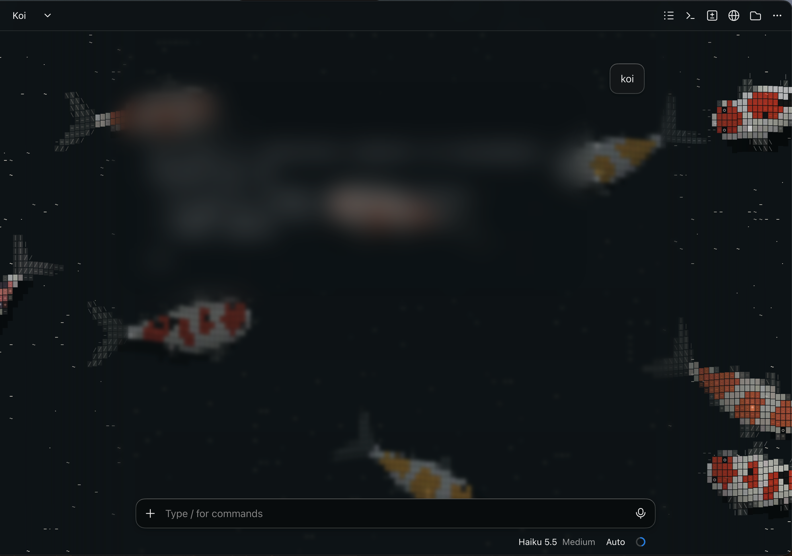

# Koi Backdrop for Claude

A calm koi pond behind your conversations in the Claude desktop app. [ASCII Koi](https://github.com/pursurer/ascii-koi) drawn in text-character tiles swim across the window, their tails beating, light glinting on their scales, over a softly drifting caustic net. The app's panels frost over the pond, so the chat stays easy to read.


## Install

At the prompt of a Claude Code terminal session:

```
/plugin install koi-backdrop --marketplace pursurer/claude-koi-backdrop
```

Answer `y` to add the marketplace, then pick a scope. From a shell:

```bash
claude plugin install koi-backdrop --marketplace pursurer/claude-koi-backdrop
```

In the desktop app, where `/plugin` does not run: click **+** next to the prompt box, then **Plugins**, **Add marketplace** with `pursurer/claude-koi-backdrop`, then **Add plugin**.

The pond appears behind the next conversation you open in the desktop app (or on mobile). A terminal has no backdrop, so there the mod only adds the `/koi` command.

## Use

| Command | What it does |
| --- | --- |
| `/koi` | Says which water is on |
| `/koi black` · `/koi blue` · `/koi white` | Changes the water |
| `/koi size <50-160>` | Makes the koi smaller or larger, in percent (default 100) |
| `/koi glass <blur 0-64> <opacity 0-1>` | Sets how the app's panels frost over the pond (default 3, 0.5) |
| `/koi off` · `/koi on` | Takes the pond away or brings it back |

Your choices are saved and used in every new session.



## Good to know

- The pond is drawn by one CSS-animated SVG: every koi is painted by ASCII Koi's own `pond.js`, unchanged.
- The app stops a backdrop's animation if it costs too much on a very busy machine. The still pond stays; open a new window to start it again.
- With **Reduce motion** turned on in macOS, the pond stays still.

## Files

```
.claude-plugin/plugin.json        the manifest
.claude-plugin/marketplace.json   makes this repository installable
hooks/register.tsx                the hooks: theme, backdrop, /koi
hooks/bake.js                     builds the animated SVG
hooks/pond.js                     ASCII Koi's pond, unchanged
tests/backdrop.test.tsx           claude plugin test
```

## Credits

The koi, their markings and the water come from [ASCII Koi](https://github.com/pursurer/ascii-koi). The slice-train way of swimming follows the `koi-mosaic` scene in Anthropic's `theme-examples` plugin.

## License

[MIT](LICENSE)
